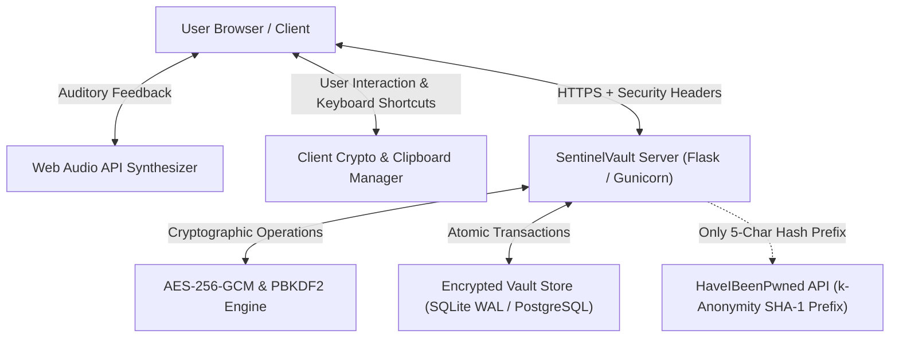

# 🛡️ SentinelVault - Industrial Zero-Knowledge Password Storage System

[](https://opensource.org/licenses/MIT)
[](https://www.python.org/)
[](#cryptographic-architecture)
[](#cryptographic-architecture)
[](#azure-app-service-deployment)

**SentinelVault** is a production-ready, industrial-grade, zero-knowledge password and secret management platform built for enterprises, security professionals, and discerning teams. Engineered from the ground up for airtight cryptographic integrity, fluid user micro-interactions, responsive high-contrast cyberpunk/industrial UI, and integrated Web Audio feedback.

---

## ⚡ Key Highlights & Industrial Capabilities

### 1. 🔐 Zero-Knowledge Cryptographic Architecture
- **Symmetric Encryption**: Every sensitive field (passwords, notes, payment card numbers, CVVs, API tokens, identities) is encrypted using **AES-256-GCM** (Galois/Counter Mode) authenticated encryption with a distinct 96-bit cryptographically secure pseudo-random initialization vector (IV) per record.
- **Key Derivation Function (KDF)**: Master keys are derived with **PBKDF2-HMAC-SHA256** using **600,000 iterations** (compliant with latest OWASP standards) and 32-byte per-user cryptographic salts.
- **Constant-Time Verification**: All authentication hashes are verified in constant time (`secrets.compare_digest`) to eliminate side-channel timing attacks.
- **Transparent Re-Encryption**: Changing your Master Password seamlessly regenerates the master encryption salt, derives a new 256-bit key, and re-encrypts all vault records in an atomic transaction.

### 2. 🛡️ Real-Time Vulnerability & Breach Auditor
- **HaveIBeenPwned k-Anonymity Integration**: Scans all stored credentials against over 10 billion known data breach records. The client never leaks plaintext passwords; only the first 5 characters of the SHA-1 hash are transmitted.
- **NIST SP 800-63B Entropy Meter**: Evaluates password entropy in bits and calculates character pool diversity in real-time.
- **Automated Reuse & Weakness Detection**: Flags duplicated credentials across services and identifies passwords with insufficient complexity.

### 3. 🔊 Procedural Web Audio Sound Engine
- Zero external media assets: All tactile micro-clicks, unlock chimes (major triad arpeggio), lock pneumatic sounds, and copy snaps are procedurally synthesized in real time via the **HTML5 Web Audio API**.
- Dedicated sound volume slider and global mute control saved in local preferences.

### 4. 📱 Integrated Live TOTP Authenticator
- Generates standard 6-digit TOTP two-factor codes for logins stored in your vault.
- Features a real-time radial 30-second countdown timer and 1-click clipboard copy.
- Supports account-level 2FA pairing with Google Authenticator, Microsoft Authenticator, and Authy via pure SVG QR codes.

### 5. 🧹 Memory-Safe Clipboard & Inactivity Auto-Lock
- **30-Second Clipboard Auto-Clear**: Automatically wipes copied secrets from the OS clipboard after 30 seconds with a real-time progress bar.
- **Inactivity Session Lock**: Blurs and protects the interface with a frosted-glass security overlay after a configurable duration of inactivity (1 to 60 minutes).

### 6. 📁 Comprehensive Vault Organization & Data Portability
- **Item Categories**: Logins, Payment Cards, Secure Monospace Notes, API Keys & Secret Tokens, and Legal Identities.
- **Favorites & Search**: Instant `Ctrl+K` keyboard shortcut fuzzy filtering across names, usernames, and tags.
- **Full Data Portability**: Import and export vault records in encrypted JSON or standard CSV (compatible with Bitwarden, 1Password, and Google Chrome).
- **Immutable Audit Trail**: Tracks and logs all authentication attempts, item accesses, updates, and exports.

---

## 📐 System Architecture



---

## 🚀 Quick Start (Local Setup)

### Prerequisites
- Python 3.10 or higher
- Git

### Installation Steps

1. **Clone the repository:**
   ```bash
   git clone https://github.com/srivatsasoham-2006/Secure-Password-Storage-System.git
   cd "Secure-Password-Storage-System"
   ```

2. **Create and activate a virtual environment:**
   ```bash
   # Windows (PowerShell)
   python -m venv venv
   .\venv\Scripts\Activate.ps1

   # Linux / macOS
   python3 -m venv venv
   source venv/bin/activate
   ```

3. **Install dependencies:**
   ```bash
   pip install -r requirements.txt
   ```

4. **Run the application:**
   ```bash
   python app.py
   ```

5. Open your browser and navigate to:
   ```
   http://127.0.0.1:5000
   ```
   *Create a new master account to initialize your vault!*

---

## ☁️ Microsoft Azure App Service Deployment

SentinelVault is optimized for **Azure Linux App Service (Python 3.12 / 3.11 / 3.13)**.

### Method 1: Automatic Deployment via GitHub Actions (Recommended)

1. Open the **Azure Portal** and navigate to your Web App: `SecurePasswordStorageSystem`.
2. Click **Deployment Center** in the left menu.
3. Select **GitHub** as the source and link `srivatsasoham-2006/Secure-Password-Storage-System`.
4. Alternatively, download the **Publish Profile** from the Azure Portal overview:
   - Go to your repository settings on GitHub: `Settings` → `Secrets and variables` → `Actions`.
   - Add a repository secret named `AZURE_WEBAPP_PUBLISH_PROFILE` with the contents of your downloaded `.publishsettings` file.
5. Push to the `main` branch:
   ```bash
   git add .
   git commit -m "Deploy SentinelVault to Azure App Service"
   git push origin main
   ```
   *The included `.github/workflows/azure-deploy.yml` workflow will automatically build and deploy the container!*

### Method 2: Azure CLI Direct Deployment

```bash
az webapp up --name SecurePasswordStorageSystem --resource-group SecurePasswordStorageSystem --runtime "PYTHON:3.12"
```

### Azure Startup Configuration
In Azure Portal under **Configuration** → **General settings** → **Startup Command**, set:
```bash
gunicorn --bind=0.0.0.0:8000 --workers=2 --threads=4 --timeout=600 app:app
```
*(Or leave empty; Azure App Service uses `app.py` or the provided `startup.sh` automatically).*

---

## ⌨️ Keyboard Shortcuts

| Shortcut | Action |
| :--- | :--- |
| `Ctrl + K` or `/` | Instant focus on the global vault search input |
| `Ctrl + N` | Open the **Add New Vault Item** modal |
| `Ctrl + L` | Instantly lock the session with the security overlay |
| `Escape` | Dismiss and close any active modal dialog |

---

## 🔒 Security Best Practices

1. **Master Password**: Always select a Master Password of at least 14-16 characters containing letters, numbers, and symbols. Your master password is the cryptographic seed for your symmetric vault key.
2. **Emergency Recovery Kit**: When initializing a new vault, download and store the provided single-use Emergency Recovery Codes in a secure offline location.
3. **HTTPS / TLS**: In production environments (such as Azure App Service), ensure HTTPS is enforced. Set `SESSION_COOKIE_SECURE=True` in your production environment variables.

---

## 📄 License
This project is released under the [MIT License](LICENSE).
